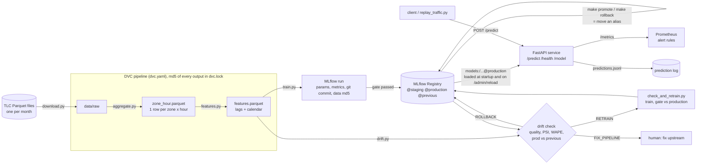

# NYC taxi demand forecast: the MLOps layer

A forecasting model that worked in a notebook, turned into a service that can be **reproduced, watched and rolled back**.

The model predicts **the number of yellow taxi pickups in a zone for the next hour**, from the recent hours and calendar features. It is deliberately simple (gradient boosting with a Poisson loss). The work is in the operations around it:

- every run logs its parameters, metrics, git commit and data hash;
- the data is versioned with DVC and the models in the MLflow Registry;
- a FastAPI service exposes Prometheus metrics, including a live drift gauge;
- a drift check turns an alarm into a decision, and a gated retraining trigger acts on it;
- rolling back is one command;
- a simulated incident shows the system in action.

> Data source: NYC Taxi & Limousine Commission (TLC), [TLC Trip Record Data](https://www.nyc.gov/site/tlc/about/tlc-trip-record-data.page), yellow taxi trip records, one Parquet file per month. The raw files are never committed: `dvc repro` downloads them again.

---

## The system on one diagram



---

## Quick start, from a fresh clone

Prerequisites: Python 3.11 to 3.13, Docker (with Docker Compose), `make`, about 1 GB of disk for the raw files.

```bash
git clone <this repo> && cd nyc-taxi-demand-mlops
make setup            # .venv + pinned dependencies + .env created from .env.example
                      # -> edit .env and set ADMIN_TOKEN to a random value
make data             # dvc repro: downloads 8 TLC months, builds zone_hour and features (~5 min)
make up               # MLflow on :5000, API on :8000, Prometheus on :9090
make train            # reference model -> MLflow run + registered version 1, alias @staging
make promote REASON="reference model"   # @production -> v1, the API reloads it
make predict          # one request: 200 with the forecast and the model version
make test             # 25 unit and integration tests (no network, no Docker needed)
```

Then open:

| URL | What |
|---|---|
| http://localhost:8000/docs | API contract (OpenAPI), try `/predict` from the browser |
| http://localhost:5000 | MLflow: experiments, runs, registered model and aliases |
| http://localhost:9090/alerts | Prometheus alert rules (inactive, pending, firing) |

To replay the whole incident (section 8): `bash scripts/run_incident.sh`.

Without `make` (Windows): every target is a single command, readable in the `Makefile`; for example `make train` is `.venv/Scripts/python -m taxi.model.train`.

---

## 1. Where each deliverable of the brief lives

| Deliverable | Where | How to see it |
|---|---|---|
| Experiment tracking: params, metrics, git commit, data hash | `src/taxi/model/train.py` | MLflow UI, experiment `nyc-taxi-demand-training`: tags `git_commit`, `git_dirty`, `data_md5` (= the md5 of `features.parquet` in `dvc.lock`), `data_path`, `trigger`, `gate` |
| Data under DVC | `dvc.yaml`, `dvc.lock`, `params.yaml`, `src/taxi/data/` | `dvc dag`, `dvc repro`, `dvc status` |
| Models in the MLflow Registry | `src/taxi/model/registry.py` | `make status`: versions, aliases, training window, git commit, data md5 |
| FastAPI service | `src/taxi/api/` | `/docs`, `make predict` |
| Integration tests | `tests/test_lifecycle.py` | `make test`: train, register, promote, serve, 422s, metrics, drift, retrain, rollback |
| Drift monitoring | live: `taxi_input_psi` gauge in the API + Prometheus rules; batch: `src/taxi/monitoring/drift.py` | Prometheus `/alerts`; `make check MONTH=2020-04` writes `reports/drift/<month>_v<version>/report.json` and `evidently.html` |
| Retraining trigger | `src/taxi/pipelines/check_and_retrain.py`, `policy.yaml` | `make retrain MONTH=2020-04` |
| Rollback procedure | `docs/ROLLBACK.md`, `make rollback` | one command, the API reloads, `make status` shows who rolled back and why |
| Simulated incident report | `docs/INCIDENT_REPORT.md`, `scripts/inject_drift.py`, `scripts/run_incident.sh` | `bash scripts/run_incident.sh` |
| Secrets in `.env`, never in Git | `.env.example`, `.gitignore`, `.dockerignore` | the only secret, `ADMIN_TOKEN`, protects `/admin/reload` |
| CI | `.github/workflows/ci.yml` | tests, Prometheus rules check (`promtool`), API image build, `dvc dag` |

---

## 2. Data and task

| Step | Choice |
|---|---|
| Raw | TLC yellow taxi files 2019-11 to 2020-06 (2019-11 is only a warm-up for the 168 h lag). Only `tpep_pickup_datetime` and `PULocationID` are read. Trips dated outside their file's month are dropped. |
| Aggregation | one row per **zone x hour**, counting pickups. Complete grid: an hour without pickups is a 0, not a missing row, so a zone that goes silent is visible. |
| Zones served | the 60 busiest zones of the **training period only** (no peek at the future), excluding "Unknown" zones 264 and 265. The API answers 422 for other zones. |
| Features | `lag_1`, `lag_2`, `lag_3`, `lag_24`, `lag_168`, `roll_mean_24` (mean of the 24 previous hours), `hour`, `day_of_week`, `is_weekend`, `is_holiday` (US federal), `zone_id` (categorical). Every lag only looks backwards inside its own zone (tested). |
| Split, by time | **reference period**: train 2019-12-01 to 2020-01-31, validation 2020-02-01 to 2020-02-29. **Drift period**: 2020-03 to 2020-06, when the COVID-19 lockdown made demand collapse (NY "PAUSE" order from 2020-03-22). |
| Metrics | **WAPE** = sum\|y - ŷ\| / sum y, the primary metric: it is scale-free, so it stays comparable when demand collapses by 90%. MAE and RMSE are logged too. **Baseline**: "same hour last week" (`lag_168`): a model that does not beat it is not registered. |
| Model | `HistGradientBoostingRegressor(loss="poisson")`: the target is a count, the model is fast to train (seconds) and to serve (milliseconds). |

---

## 3. Tracking and versioning: how to rebuild any model

Each training run logs to MLflow:

- **params**: hyperparameters, train and validation windows, number of rows and zones, feature list;
- **metrics**: `valid_wape`, `valid_mae` and `valid_rmse`, the train metrics, the naive baseline (`naive_valid_*`), and the production model on the same holdout (`production_valid_*`) when gating a retrain;
- **tags**: `git_commit`, `git_dirty`, `data_md5`, `data_path`, `trigger` (`manual`, `drift:<window>`, `scheduled`) and `gate`;
- **artifacts**: the model (signature + input example) and `monitoring/reference_profile.json`. The profile holds the PSI bins of the training data, the mean pickups per zone and the validation WAPE, which the API and the drift check compare against.

A model is registered only if it passes the gate. It gets the alias `@staging`, and a human moves `@production`.

**To rebuild version N exactly**: read its `git_commit` and `data_md5` in `make status` or the MLflow UI, then:

```bash
git checkout <git_commit>
dvc checkout            # or dvc repro: same params.yaml -> same features.parquet (same md5)
python -m taxi.model.train --train-start ... --train-end ... --valid-start ... --valid-end ...   # windows from the run params
```

The DVC remote is a local folder by default (`dvc remote list`). To share the data inside the team without re-downloading, point it to a shared storage: `dvc remote add -d -f storage gdrive://<folder id>` (or S3), then `dvc push` / `dvc pull`.

---

## 4. The API

| Endpoint | |
|---|---|
| `GET /health` | `200 {"status": "ok", "model_version": "2"}`, or `503 degraded` when no model is loaded: a container can be up and still not ready |
| `GET /model` | version, run id, training window, validation WAPE, number of zones |
| `POST /predict` | forecast for one zone and one hour |
| `POST /admin/reload` | reloads `@production` after a promotion or a rollback, header `X-Admin-Token` required |
| `GET /metrics/` | Prometheus metrics |

```bash
curl -X POST localhost:8000/predict -H "Content-Type: application/json" -d '{
  "zone_id": 237, "hour_start": "2020-02-14T18:00:00",
  "lag_1": 310, "lag_2": 295, "lag_3": 260, "lag_24": 280, "lag_168": 301, "roll_mean_24": 190.5}'
# {"request_id": "...", "zone_id": 237, "hour_start": "2020-02-14T18:00:00",
#  "predicted_pickups": <float>, "model_version": "1", "model_ms": <float>}
```

The contract is enforced by Pydantic before any model code runs. A negative count, `zone_id` 999, a missing lag or an **unknown extra field** gets a 422 that names the field: 422 is the caller's fault, 500 is ours. The calendar features are computed by the API from `hour_start` with the same function as in training. The model is loaded once at startup, never inside `/predict`. Each response carries `X-Process-Time-Ms` and `X-Request-ID`, and each prediction is appended to `logs/predictions.jsonl` (one JSON line: `request_id`, model version, zone, hour, prediction).

The image (`docker/api.Dockerfile`) contains code and configuration only: no data, no model, no secret. The model comes from the Registry. Images are tagged with a version (`API_IMAGE_TAG`), never `latest`.

---

## 5. Monitoring: the four layers of the course

| Layer | Question | What we measure | Where |
|---|---|---|---|
| 1. Infrastructure | is it up and fast? | `taxi_request_seconds` histogram (P95 budget 200 ms), `taxi_http_requests_total{status}`, `up`, `taxi_model_loaded` | Prometheus rules `ApiDown`, `LatencyP95AboveBudget`, `NoModelLoaded` |
| 2. Input | does today's data look like training data? | **live**: PSI per feature over the last 1000 requests, recomputed every 50, gauge `taxi_input_psi{feature}`; **batch**: PSI per feature + Evidently report + quality checks | rules `FeatureDriftWatch` (> 0.10) and `FeatureDriftAct` (> 0.25); `make check` |
| 3. Prediction | does the model behave as before? | `taxi_predicted_pickups` histogram per model version, `taxi_predictions_total{model_version}` | Prometheus |
| 4. Outcome | is the model still right? | WAPE of production on the window's actual pickups, vs its validation WAPE and vs `@previous` | `make check` |

For taxi demand, the label arrives one hour later (the pickups of that hour), so layer 4 is cheap here: the batch check scores the production model on the real counts of the window. Metric labels stay low-cardinality (`feature`, `endpoint`, `status`, `model_version`); identifiers such as `request_id` only go to the log.

---

## 6. Drift check and retraining trigger

`make check MONTH=2020-04` runs `src/taxi/monitoring/drift.py` on a window, against the `@production` model and the data it was trained on. The thresholds live in `policy.yaml`, so changing one is a reviewed commit. It follows the course's decision tree, in this order:

| # | Question | Check | Decision |
|---|---|---|---|
| 1 | Is it a bug? | a zone that should still see 5+ pickups per hour **given the city's current volume** reports 0 for 24 consecutive hours; an hour with no trip in the whole city; duplicates; negatives | `FIX_PIPELINE`: never retrain on it, even with `--force` |
| 2 | Did the last deployment make things worse? | on fresh labels: production WAPE > 1.10 x `@previous` WAPE, or a busy zone > 2x worse, or production misses its own validation WAPE by > 3x while `@previous` stays within 1.5x of its own (leakage, train/serve skew) | `ROLLBACK` |
| 3 | Did the inputs move? | max PSI per feature: ≤ 0.10, ≤ 0.25, > 0.25 | `OK`, `WATCH`, go on |
| 4 | Does it hurt? | production WAPE / validation WAPE ≥ 1.20 | otherwise `WATCH` |
| 5 | Enough new data? | at least 14 days in the window | otherwise `WAIT_FOR_DATA` |
|   | | | `RETRAIN` |

`make retrain MONTH=...` (`check_and_retrain.py`) runs the check and acts only on `RETRAIN`:

1. It trains a candidate on the last 35 days of the window and holds out the last 7.
2. **The gate**: the candidate must beat the naive baseline, and beat production on the same holdout by at least 2%.
3. If it passes, it is registered as `@staging` and a human promotes it with `make promote` (`auto_promote: false`). If it fails, it is logged but not registered, and production does not change.

`--force` retrains even without drift (the "scheduled floor" of the hybrid policy). It is logged as `trigger=scheduled` and never overrides `FIX_PIPELINE` or `ROLLBACK`.

PSI is a rule of thumb, not a test, so each report also includes an Evidently `DataDriftPreset` HTML report (statistical tests per column) and logs everything to MLflow (experiment `nyc-taxi-demand-monitoring`).

---

## 7. Rollback

```bash
make rollback REASON="why"     # @production -> @previous, API reloaded, ~2 s
make rollback VERSION=3 REASON="why"   # or to an explicit version
```

Rolling back moves an alias: no rebuild, no redeploy, and the old version is still in the Registry. The rolled-back version keeps tags saying who, when and why. The full runbook (when, how, how to check, how to roll forward) is in [docs/ROLLBACK.md](docs/ROLLBACK.md).

---

## 8. The incident

[docs/INCIDENT_REPORT.md](docs/INCIDENT_REPORT.md) tells one story in three events. `scripts/run_incident.sh` replays it:

1. **Real drift, retrain.** The April 2020 lockdown sends every PSI above 0.25 and the WAPE far above validation. The decision is `RETRAIN`: the candidate passes the gate and is promoted, and the live PSI calms down against the new reference.
2. **Injected bug A, no retrain.** Zone 237 goes silent in May (`scripts/inject_drift.py --mode zone_silent`). The PSI barely moves, because one zone is diluted among 60. The quality check sees it, decides `FIX_PIPELINE` and refuses to retrain, even with `--force`.
3. **Injected bug B, rollback.** A feature refactor forgets a shift, so `lag_1` becomes the target (`--mode leaky_feature`). The scheduled retrain looks excellent on a holdout that has the same leak, so it passes the gate and gets promoted. On the clean June labels, production misses its validation WAPE by x355 while `@previous` stays at x1.09: the check decides `ROLLBACK`, and `make rollback` restores v2 in under 4 seconds. The lineage (`data_md5` different from `dvc.lock`) points to the corrupted data.

The real data made us fix two rules, both described in the report. The silent-zone check first flagged two small zones that were truly empty during the lockdown, so it is now scaled by the city's volume. And the leaky model was not worse than v2 on June overall, so a "validation gap" rule was added.

---

## 9. Live demo (presentation)

**Before the session**: `make data`, `make up`, `make train`, `make promote`, then `make retrain MONTH=2020-04`. The state is v1 `@production` (pre-COVID) and v2 `@staging` (lockdown). Keep a terminal, the API `/docs`, MLflow and Prometheus `/alerts` open.

| Time | Action | What the jury sees |
|---|---|---|
| 0:00 | `make status`, `curl localhost:8000/health` | v1 in production, v2 waiting in staging, with commit and data md5 |
| 0:30 | `make predict`, then the same request with `"lag_1": -3` in `/docs` | a 200 with the forecast and the model version, then a 422 naming the field |
| 1:00 | `make replay START=2020-02-01 END=2020-02-29` | PSI gauges near 0 on `/metrics/`, `/alerts` all inactive |
| 2:00 | `make replay START=2020-04-01 END=2020-04-30` | `taxi_input_psi` above 0.25, `FeatureDriftAct` pending then **firing** |
| 3:00 | `make check MONTH=2020-04` | the decision tree: PSI act, WAPE ratio, `RETRAIN`; the Evidently report |
| 4:00 | `make promote REASON="lockdown"`, replay April again | the API now answers with v2; the PSI falls back under 0.10 against v2's own reference |
| 5:00 | `make rollback REASON="demo"`, `make predict` | alias moved in ~2 s, the next answer comes from v1; `make status` shows who and why |

**Backup plan if the demo fails**: the reports of a full run are kept in `reports/drift/` (JSON + Evidently HTML), the MLflow volume keeps every run, and the incident report has the numbers. Take screenshots of the firing alert and of the MLflow Registry during rehearsal. Once `make data` has run, the demo needs no internet.

---

## 10. Design choices and trade-offs

| Choice | Why | Trade-off accepted |
|---|---|---|
| A simple gradient boosting with a Poisson loss | the brief grades operations, not the model; trains in seconds, so retraining is cheap | a stronger model (per-zone, weather, events) would forecast better |
| Lags sent by the caller | the API stays stateless and fast; the contract is explicit and validated | the caller must compute the lags; a feature store would remove that (another month) |
| WAPE as the primary metric | scale-free: comparable before and after a 90% collapse | less intuitive than MAE for a single zone |
| Promotion and rollback by MLflow aliases | one source of truth for "what is in production"; rollback without rebuild | the API must be told to reload (`/admin/reload`); a Kubernetes rollout would do it per pod |
| Retraining gated, promotion by a human | a failed gate costs a training run, a bad model in production costs money | slower reaction than full automation |
| PSI per feature, not only a dataset verdict | one strong drift among calm columns is not diluted | PSI thresholds are conventions, so Evidently's tests are kept alongside |
| Quality checks before any retraining | a broken pipeline looks exactly like drift | a real event that silences a zone for a day would also be flagged, and a human decides |
| Batch drift check run by command, not by a scheduler | the whole loop runs on a laptop from a fresh clone | in production it would be a nightly job (Airflow) |
| No Kubernetes, no Grafana, no Alertmanager | not required by the brief; Prometheus' own `/alerts` page is enough to show an alert firing | no dashboards, no paging |
| DVC remote on a local folder | works from a fresh clone with no account | the team shares data through `dvc repro` (or a Google Drive remote) |

## 11. With another month

- Schedule the loop: an Airflow DAG `check_drift -> decide -> retrain` every night, and a GitHub Actions `workflow_dispatch` for the retrain with an approval environment for `@production`.
- Canary deployment: serve the `@staging` version to 10% of traffic and compare its live metrics before promoting.
- A "too good to be true" gate: block a candidate whose WAPE improves by more than X% at once. In the incident, the leaky model jumped from 0.311 to 0.001.
- A bias check on layer 4: after the rollback, v2 under-forecasts June by 28% while its WAPE ratio (1.09) stays under the retraining threshold.
- A Grafana dashboard and Alertmanager routes to Slack.
- A small feature service so callers send only `zone_id` and `hour_start`.
- Better model: weather, events, per-borough models, prediction intervals.

---

## Repository layout

```
params.yaml            data, split, features and model parameters (tracked by DVC)
policy.yaml            drift, quality, retraining and rollback thresholds
dvc.yaml / dvc.lock    data pipeline and md5 of every output
src/taxi/data/         download, aggregate, features, quality checks
src/taxi/model/        train (+ gate + registration), registry (promote, rollback, status)
src/taxi/monitoring/   PSI, batch drift check and decision tree
src/taxi/pipelines/    retraining trigger
src/taxi/api/          FastAPI app and contract
scripts/               inject_drift.py, replay_traffic.py, run_incident.sh
monitoring/            Prometheus config and alert rules
docker/, docker-compose.yml
tests/                 unit and integration tests
docs/                  incident report, rollback runbook
```

## Team

| Member | Owns | Defends |
|---|---|---|
| Lynn-Aurea NIAT | data pipeline, DVC, drift check and policy | why WAPE, why PSI per feature, why quality checks before retraining |
| Sereine TAWAMBA | MLflow tracking and Registry, API, tests, rollback | why aliases, why a 422 contract, how a rollback works |
| Nicolas DOLLET | monitoring stack, incident simulation, CI | the four layers, the incident timeline |
| Name KANOUTE | monitoring stack, incident simulation, CI | the four layers, the incident timeline |
| Khaled ENLAGAR | monitoring stack, incident simulation, CI | the four layers, the incident timeline |


## Evidence: the system running on the real TLC data

Screenshots of the run of 20 November 2026 (full logs in `reports/incident_run.log`).

| What | Screenshot |
|---|---|
| MLflow Registry: v2 in production, v3 rolled back with its reason |  |
| A run's metrics and lineage (git commit, data md5, gate) |  |
| A run's parameters (windows, model, zones) |  |
| `POST /predict`: 200 with the model version |  |
| `POST /predict` with `lag_1 = -3`: 422 naming the field |  |
| April 2020 traffic: drift alerts firing in Prometheus |  |
| Live PSI above 5 on every feature |  |
| CI green on every push |  |


